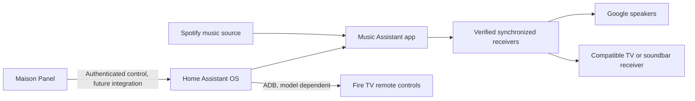

# Portable home server and shared music

Status: proposed architecture, October 11, 2026. No server installed or audio grouping verified.

## Current decision: no purchases, TV optional

The user wants to use existing equipment and the current PC if a server is needed.
This supersedes the purchase candidate below. First test the supported Bluetooth route:

1. Put the Samsung soundbar into Bluetooth pairing mode.
2. In Google Home, select the nearby Google speaker, then Settings > Audio > Default music
   speaker > Pair Bluetooth speaker. Select the Samsung soundbar.
3. Create a group named Maison containing both Google speakers, and cast Spotify to that group.
4. The paired Google speaker sends its music to the soundbar; the other Google speaker plays
   locally. This produces two audible music outputs, not all three physical speakers.
5. Test delay and reconnect behavior; use Google's group-delay correction if needed.
   The TV can be off. Switch the soundbar back to optical input when using TV audio.

Google explicitly documents including Bluetooth outputs through their paired Home devices:
[Bluetooth speaker grouping](https://support.google.com/googlehome/answer/7672356?hl=en).
Physical pairing must be completed on the user's phone and soundbar; it has not been done here.

Read-only inspection of the current PC found an Intel Core i5-7500 and 16 GB RAM. These are
adequate for a small Home Assistant pilot. Windows reports a hypervisor present but reports
VirtualizationFirmwareEnabled false; resolve that discrepancy and identify the available VM
platform before installation. No Bluetooth adapter appeared in the present-device query.
The recommended Google-to-soundbar route does not require Bluetooth on the PC.

If all three physical speakers must play, a PC audio client plus Music Assistant's experimental
Sendspin-on-Cast route is a separate feasibility test, not a promised upgrade. A server must not
be installed merely to reproduce the supported two-output setup above. The existing backup/restore
design below remains the migration approach if broader home control warrants a server.

## Goal and known equipment

Play one Spotify session through the TV's Samsung soundbar and both Google speakers,
with no audible echo. Control playback from Maison Panel. Later add Fire TV remote controls.
Move any pilot on the current Windows PC to the old Dell without rebuilding the configuration.

The Samsung HW-B53C/ZC soundbar currently receives optical audio from a Samsung UN49KU6490FXZC TV.
Google speakers are believed to be
first and second generation; exact models are unconfirmed. Dell model, memory, disk and boot
capabilities remain unknown. Fire TV model/OS and available TV HDMI ports still need confirmation.

Samsung's [HW-B53C specifications](https://www.samsung.com/ca/business/audio-devices/soundbar/b53c-black-hw-b53c-zc/)
confirm no Wi-Fi, but optical, Bluetooth, HDMI input/output, ARC and CEC. It cannot join a Cast group
directly. The [TV model is confirmed by Samsung support](https://www.samsung.com/ca/support/model/UN49KU6490FXZC/);
do not infer newer TV features from the generic support articles on that page.

The preferred candidate is a Google TV Streamer (4K) at a free TV HDMI input, retaining optical
output to the soundbar. Google explicitly lists it for
[multi-device media playback](https://support.google.com/chromecast/answer/10012636?hl=en-AU).
Group it with the two Google speakers and cast Spotify to the group. This is a supported architecture
to test, not a verified result on this household's equipment. The TV must remain on the receiver's input.
Keep the Fire TV on another input for its usual apps. Verify ports and delay before purchase.

## Choose the audio route before the server

1. First test the two Google speakers in one Google Home speaker group. Home Mini first generation
   and Nest Mini second generation are supported; they need not be a matching stereo pair.
2. Check whether the TV or soundbar already offers a receiver that can join that group.
   Otherwise investigate a compatible Google Cast receiver connected to a TV HDMI input, with
   audio continuing through the existing optical connection to the soundbar. Verify the exact
   receiver's group support, available ports and audio delay before buying anything.
3. Select that group from Spotify. This route may satisfy shared music without a server.
   It uses Cast playback, not necessarily the native Fire TV Spotify app or its on-screen interface.
4. If that route is unsuitable, evaluate Music Assistant with supported synchronized players.
   Universal Groups are not a solution for echo-free playback. Sendspin bridging to Cast is
   experimental and firmware-dependent; use only after a successful test with these speakers.

An optical cable alone does not add network grouping. Installing Home Assistant does not turn
the Fire TV Spotify app into a synchronized Google receiver. TV/soundbar processing can add
delay even with a supported Cast group; test and adjust using Google's group-delay setting.

Sources: [Google groups](https://support.google.com/googlehome/answer/7174267?hl=en),
[delay correction](https://support.google.com/googlehome/answer/6318642?hl=en-GB),
[Music Assistant grouping](https://www.music-assistant.io/faq/groups/).

## Server design if we proceed

Use Home Assistant OS in a VM for the Windows pilot, with Music Assistant installed as its app.
Use a bridged network connection so supported local devices can be discovered. The Dell can later
run Home Assistant OS directly if compatible; preserving its existing OS would require a VM instead.
Check hardware and existing data before selecting the installation method.

The existing cloud dashboard remains usable independently. Local controls require a separately
implemented authenticated connection: begin with a Home Assistant dashboard on the LAN; then
integrate Maison through a compatible HTTPS endpoint and explicit origin/auth configuration.
The hosted HTTPS panel cannot simply call a LAN HTTP server. Keep credentials out of the public
repository; do not expose ADB publicly. Store the service address in one setting, with stable
entity names, rather than scattering PC-specific IP addresses or paths through tiles.

References: [Windows installation](https://www.home-assistant.io/installation/windows/),
[Dell/x86 installation requirements](https://www.home-assistant.io/installation/generic-x86-64/),
[Music Assistant installation](https://www.music-assistant.io/installation/),
[Fire TV via ADB](https://www.home-assistant.io/integrations/androidtv/).

## Migration checklist

1. Record server version, hostname, entity names, integrations and endpoint settings privately.
2. Create a Home Assistant backup including Music Assistant and its data. Download it and retain
   the encryption emergency kit privately, outside Git. Verify the backup's contents before moving.
3. Install compatible Home Assistant OS on the Dell. Restore the backup during onboarding.
   Ensure available storage exceeds the restored data size.
4. Shut down the pilot before activating the restored instance to avoid duplicate controllers.
   Move the router's address reservation or update the single panel endpoint setting.
5. Verify Spotify authorization, player discovery and Fire TV pairing; reauthorize if required.
6. Keep the original VM powered off as rollback until the new server passes acceptance checks.

Home Assistant supports backup migration between hardware types. This is a restore procedure,
not a promise that every external device will preserve its authorization automatically.
See [backup and restore documentation](https://www.home-assistant.io/common-tasks/general/#backups).

## Acceptance before calling it ready

- Listen to all outputs together for 30 minutes, including track changes, pause/resume and seeking.
- Confirm no audible echo at a location where the soundbar and Google speakers can both be heard.
- Test TV input selection and volume; optical soundbar volume may require a separate control route.
- Reboot the server and receivers, then confirm discovery and playback recover.
- Restore a backup onto the destination machine and repeat playback and panel-control checks.
- With the server off, verify the existing dashboard still loads and local controls show unavailable.

Next information needed: free TV HDMI port, Fire TV model/OS, and Dell model/RAM.
No hardware purchase or installation is selected until those checks resolve the audio route.
